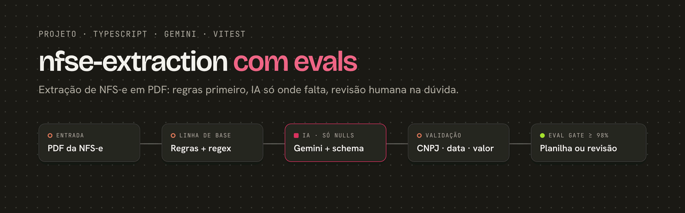
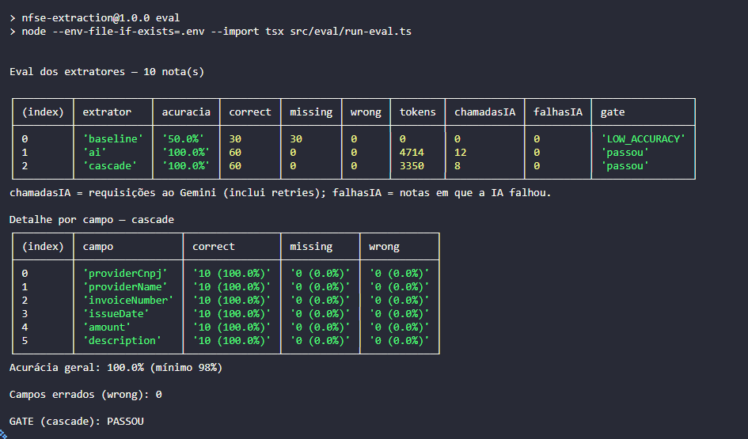

# nfse-extraction

Extrai os campos de uma **NFS-e** (nota fiscal de serviços eletrônica) em PDF e mede a qualidade com uma **eval com gate de acurácia**. As regras determinísticas rodam primeiro. A **IA só entra para preencher o que faltou**, e qualquer valor incerto vai para revisão humana em vez de ser gravado.

> **Status:** projeto de portfólio em evolução. Os dados são **100% fictícios**: nenhuma nota, CNPJ ou empresa real é usada.

## O problema

Um analista de contas a pagar digita à mão os dados de cada NFS-e recebida. Isso é lento e gera erros caros, como pagamento duplicado ou pagamento ao fornecedor errado. O projeto automatiza a extração sem abrir mão do controle: **na dúvida, um humano revisa**.

Campos extraídos: CNPJ do prestador, razão social, número da nota, data de emissão, valor e descrição do serviço.

## Como funciona

```
PDF ─► texto (unpdf) ─► linha de base (regras) ─► faltou campo? ─► IA (Gemini + JSON Schema) ─► validação ─► resultado
```

1. **Linha de base determinística.** Expressões regulares e regras extraem o que for possível, sem custo de IA.
2. **Cascata.** O Gemini só é chamado se sobrar campo vazio, e só preenche esses campos. Um valor da linha de base nunca é sobrescrito.
3. **A resposta do modelo é tratada como não confiável.** A saída é forçada por JSON Schema e cada campo é validado: CNPJ com dígito verificador, data real e não futura, valor maior que zero. Campo inválido vira `null` e não um chute.
4. **Proteção contra prompt injection.** O texto da nota vai delimitado, e o modelo é instruído a tratá-lo apenas como dado.
5. **Falha da IA não derruba o fluxo.** Se a chamada falhar, o resultado da linha de base é mantido e a falha é registrada por código.

## Eval

A eval compara três extratores sobre o mesmo dataset e calcula a acurácia por campo (`correct` / `missing` / `wrong`). O **gate** reprova a entrega se a acurácia ficar abaixo de **98%** ou se houver **um único valor ou CNPJ errado**, os dois campos que mais custam caro quando erram.

Resultado em 10 notas fictícias:

| Extrator | Acurácia | Errados | Tokens | Chamadas à IA | Gate |
|---|---|---|---|---|---|
| Linha de base (só regras) | 50,0% | 0 | 0 | 0 | reprovado |
| Só IA | 100,0% | 0 | 4.714 | 12 | passou |
| **Cascata (regras + IA)** | **100,0%** | **0** | **3.350** | **8** | **passou** |

A cascata alcança a mesma acurácia da IA sozinha com **29% menos tokens** e **33% menos chamadas**.



**Próximo passo:** ampliar o dataset de 10 para 50 notas, com layouts de prefeituras diferentes e casos difíceis.

## Stack

- **TypeScript** (strict, ES Modules) e **Node.js 24**
- **Gemini API** (`@google/genai`), modelo `gemini-3.1-flash-lite`, com saída em JSON Schema
- **unpdf** para extrair texto de PDF
- **Vitest** para testes unitários, com os testes espelhando `src/`
- **Puppeteer** para gerar os PDFs fictícios do dataset a partir de HTML

## Estrutura

```
src/
  ai/           cliente do Gemini (retries e contagem de tokens)
  extraction/   pdf-to-text, linha de base, extrator por IA e cascata
  validators/   CNPJ, valor e data de emissão
  eval/         comparação, métricas por campo e gate
datasets/nfse/  notas fictícias (HTML, PDF e gabarito .expected.json)
tests/          testes unitários
docs/           intenção do projeto e capturas
```

## Como rodar

```bash
npm install
cp .env.example .env      # preencha GEMINI_API_KEY
npm test                  # testes unitários
npm run typecheck
npm run eval              # roda a eval (chama a API do Gemini)
```

## Fora do escopo

O projeto não paga nem aprova pagamentos, não se integra com ERP e não lê PDF escaneado (OCR).

---

Feito por **Analice Ferreira**, AI Automation Engineer. [LinkedIn](https://www.linkedin.com/in/analiceferreirads) · [GitHub](https://github.com/analiceferreirads1)
