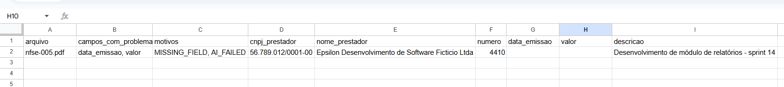

# nfse-extraction

> **Problema:** analistas de contas a pagar digitam à mão cada nota fiscal de serviço, e um único erro de digitação pode virar um pagamento duplicado ou ao fornecedor errado.<br>
> **Resultado:** em 10 notas fictícias com layouts variados, a cascata (regras + IA) acertou 100% dos campos, sem nenhum valor errado. Quando a IA falha, a nota vai para revisão humana em vez de receber um valor inventado.<br>
> **Custo:** a cascata gasta 29% menos tokens que a IA sozinha. Cada chamada à IA custa cerca de US$ 0,00025, ou seja, cerca de US$ 0,25 por 1.000 chamadas à IA no plano pago do Gemini ([conta](#eval)).

Extrai os campos de uma **NFS-e** (nota fiscal de serviços eletrônica) em PDF e mede a qualidade com uma **eval com gate de acurácia**. As regras determinísticas rodam primeiro. A **IA só entra para preencher o que faltou**, e qualquer valor incerto vai para revisão humana em vez de ser gravado.

> **Status:** projeto de portfólio em evolução. Os dados são **100% fictícios**: nenhuma nota, CNPJ ou empresa real é usada.

## O problema

Um analista de contas a pagar digita à mão os dados de cada NFS-e recebida. Isso é lento e gera erros caros, como pagamento duplicado ou pagamento ao fornecedor errado. O projeto automatiza a extração sem abrir mão do controle: **na dúvida, um humano revisa**.

Campos extraídos: CNPJ do prestador, razão social, número da nota, data de emissão, valor e descrição do serviço.

## Como funciona

```
PDF ─► texto (unpdf) ─► linha de base (regras) ─► faltou campo? ─► IA (Gemini + JSON Schema) ─► validação ─► decisão
                                                                                                              │
                                     ┌────────────────────────────────────────────────────────────────────────┤
                                     ▼                                                                        ▼
                               aprovadas.csv                                                            revisao.csv
                         (tudo preenchido e válido)                                     (campo vazio ou inválido, ou a IA falhou)
```

1. **Linha de base determinística.** Expressões regulares e regras extraem o que for possível, sem custo de IA.
2. **Cascata.** O Gemini só é chamado se sobrar campo vazio, e só preenche esses campos. Um valor da linha de base nunca é sobrescrito.
3. **A resposta do modelo é tratada como não confiável.** A saída é forçada por JSON Schema e cada campo é validado: CNPJ com dígito verificador, data real e não futura, valor maior que zero. Campo inválido vira `null` e não um chute.
4. **Proteção contra prompt injection.** O texto da nota vai delimitado, e o modelo é instruído a tratá-lo apenas como dado.
5. **Falha da IA não derruba o fluxo.** Se a chamada falhar, o resultado da linha de base é mantido e a falha é registrada por código.
6. **Decisão.** Uma nota com todos os campos preenchidos e válidos vai para `aprovadas.csv`. Campo vazio, campo inválido ou falha da IA mandam a nota para `revisao.csv`.

## Eval

A eval compara três extratores sobre o mesmo dataset e calcula a acurácia por campo (`correct` / `missing` / `wrong`). O **gate** reprova a entrega se a acurácia ficar abaixo de **98%** ou se houver **um único valor ou CNPJ errado**, os dois campos que mais custam caro quando erram.

Resultado em 10 notas fictícias:

| Extrator | Acurácia | Errados | Tokens | Chamadas à IA | Gate |
|---|---|---|---|---|---|
| Linha de base (só regras) | 50,0% | 0 | 0 | 0 | reprovado |
| Só IA | 100,0% | 0 | 4.714 | 12 | passou |
| **Cascata (regras + IA)** | **100,0%** | **0** | **3.350** | **8** | **passou** |

A cascata alcança a mesma acurácia da IA sozinha com **29% menos tokens** e **33% menos chamadas**.


**Conta do custo.** A eval mostra só o total de tokens. A divisão entre entrada e saída vem de uma chamada real ([print](docs/screenshots/01-first-real-ai-call.png)): 334 tokens de entrada e 108 de saída. Preço do `gemini-3.1-flash-lite` no plano Standard pago: US$ 0,25 por 1M de tokens de entrada e US$ 1,50 por 1M de saída ([tabela oficial](https://ai.google.dev/gemini-api/docs/pricing), consultada em 10/11/2026).

```
334 × 0,25 / 1.000.000 + 108 × 1,50 / 1.000.000 ≈ US$ 0,00025 por chamada  →  ≈ US$ 0,25 por 1.000 chamadas à IA
```

É uma estimativa feita a partir de uma única chamada. O número de tokens varia de nota para nota.

## Saída e revisão humana

```bash
npm run process -- <pasta-com-pdfs>
```

Cada execução cria uma subpasta nova, `output/AAAA-MM-DD_HHMMSS/`, com dois arquivos:

- **`aprovadas.csv`**: notas com os 6 campos preenchidos e válidos. "Aprovada" diz respeito só à extração. O projeto não aprova pagamento.
- **`revisao.csv`**: notas que precisam de um humano, com as colunas `campos_com_problema` e `motivos` (códigos como `MISSING_FIELD`, `AI_FAILED`, `INVALID_CNPJ`, `INVALID_AMOUNT`, `INVALID_DATE` e `FUTURE_DATE`), além dos valores já extraídos. Quem revisa só completa o que falta.

Execuções anteriores nunca são apagadas nem sobrescritas. Se o nome da pasta já existir, a nova recebe o sufixo `_2`, `_3` e assim por diante.

Os CSVs saem no formato do Excel em português: `;` entre colunas, vírgula decimal, CRLF e BOM UTF-8 (para os acentos aparecerem certos). O CNPJ sai com máscara e a data em `dd/mm/aaaa`. Células de texto que começam com `=`, `+`, `-` ou `@` são neutralizadas, como proteção contra CSV injection.

**Caso real:** na primeira execução, a IA falhou na `nfse-005`. A nota foi para revisão com os motivos `MISSING_FIELD` e `AI_FAILED` e os campos com problema `data_emissao` e `valor`. Esses dois campos ficaram em branco, sem valores inventados. Os campos que a linha de base extraiu continuaram preenchidos.



## Decisões de arquitetura

- **Subpastas por execução em vez de banco de dados.** A usuária abre os resultados no Excel, e cada lote fica guardado para consulta. Vale migrar para um banco quando houver vários usuários, necessidade de auditoria ou integração com ERP.
- **Cascata em que a linha de base nunca é sobrescrita.** A IA só preenche campos que as regras deixaram vazios. Um valor determinístico não é trocado pelo palpite do modelo.
- **Reenvio próprio, com o da SDK desligado.** O cliente faz no máximo 3 tentativas, e só em erro 429 ou 5xx, com espera crescente (1 s, 2 s). Outros erros falham na hora. A SDK não recebe `retryOptions`, então não faz reenvios por conta própria. Assim, cada tentativa gera uma linha de log e entra na contagem de chamadas da eval.
- **Modelo menor (`gemini-3.1-flash-lite`).** A tarefa é simples: completar poucos campos a partir de um texto curto, com saída em JSON Schema.

## Limites conhecidos

- **Dataset pequeno e fictício:** são só 10 notas; a meta do projeto é medir em 50.
- **A IA não é determinística:** a mesma nota pode dar resultados diferentes em execuções diferentes. Na eval, a cascata acertou 100%; no `npm run process`, a IA falhou na `nfse-005`.
- **O Excel apaga zeros à esquerda do número da nota** (por exemplo, `000317` vira `317`). Para preservar os zeros, abra o arquivo por **Dados > De Texto/CSV** e defina a coluna `numero` como **Texto**.
- **Não há política de retenção dos lotes (LGPD):** as pastas em `output/` ficam guardadas por tempo indeterminado. A pasta está no `.gitignore` e não vai para o repositório.

## Próximos passos

- Ampliar o dataset para 50 notas, com layouts de prefeituras diferentes e casos difíceis.
- Gravar a saída em `.xlsx`.
- Definir uma política de retenção de dados.
- Pedir à IA só os campos que faltam (hoje ela recebe o pedido completo e a cascata aproveita apenas os campos vazios).
- Usar a discordância entre a linha de base e a IA como sinal de revisão.

## Stack

- **TypeScript** (strict, ES Modules) e **Node.js 24**
- **Gemini API** (`@google/genai`), modelo `gemini-3.1-flash-lite`, com saída em JSON Schema
- **unpdf** para extrair texto de PDF
- **Vitest** para testes unitários, com os testes espelhando `src/`
- **Puppeteer** para gerar os PDFs fictícios do dataset a partir de HTML

## Estrutura

```
src/
  ai/           cliente do Gemini (retries e contagem de tokens)
  extraction/   pdf-to-text, linha de base, extrator por IA e cascata
  validators/   CNPJ, valor, data de emissão e decisão (aprovada ou revisão)
  pipeline/     processamento de uma nota e de uma pasta
  output/       formatação dos CSVs e nome da subpasta da execução
  cli/          comando npm run process
  eval/         comparação, métricas por campo e gate
datasets/nfse/  notas fictícias (HTML, PDF e gabarito .expected.json)
tests/          testes unitários
docs/           intenção do projeto e capturas
```

## Como rodar

```bash
npm install
cp .env.example .env      # preencha GEMINI_API_KEY
npm test                  # testes unitários
npm run typecheck
npm run eval              # roda a eval (chama a API do Gemini)
npm run process -- datasets/nfse   # grava output/AAAA-MM-DD_HHMMSS/ (chama a API do Gemini)
```

## Fora do escopo

O projeto não paga nem aprova pagamentos, não se integra com ERP e não lê PDF escaneado (OCR).

---

Feito por **Analice Ferreira**, AI Automation Engineer. [LinkedIn](https://www.linkedin.com/in/analiceferreirads) · [GitHub](https://github.com/analiceferreirads1)
